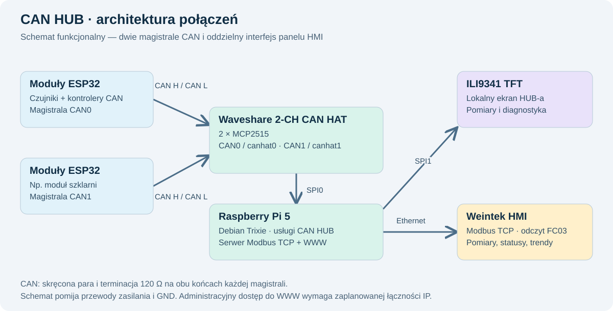
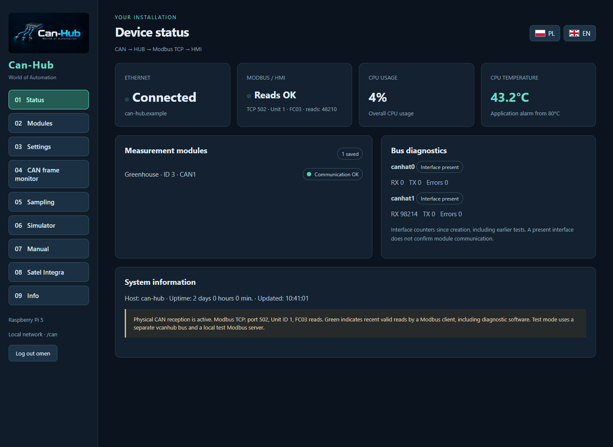
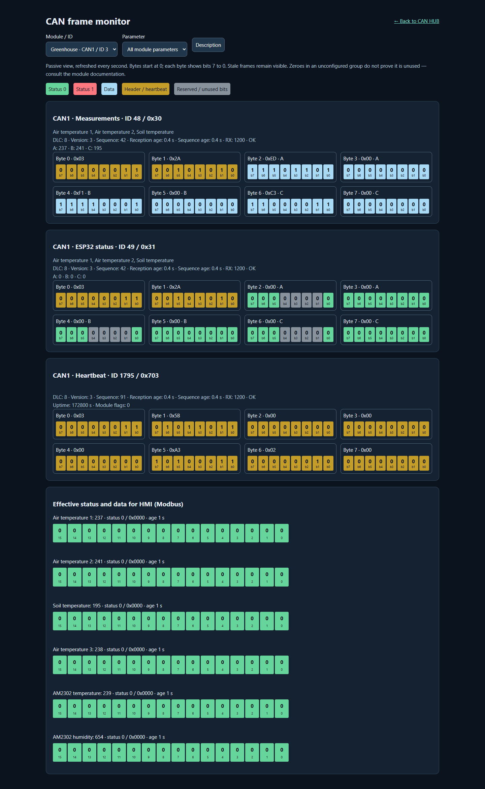
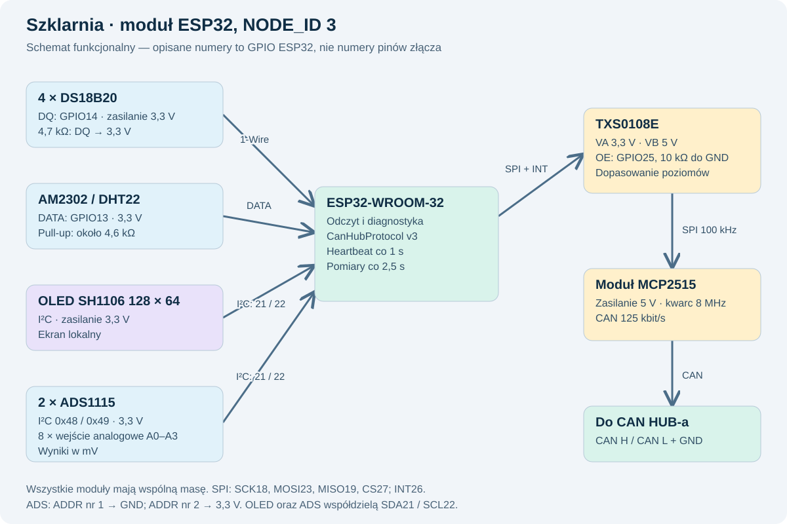
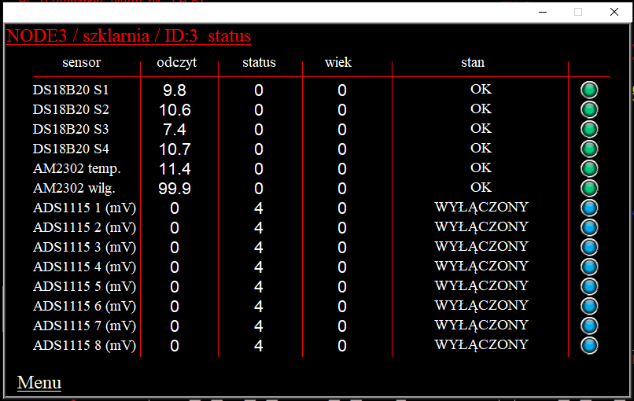
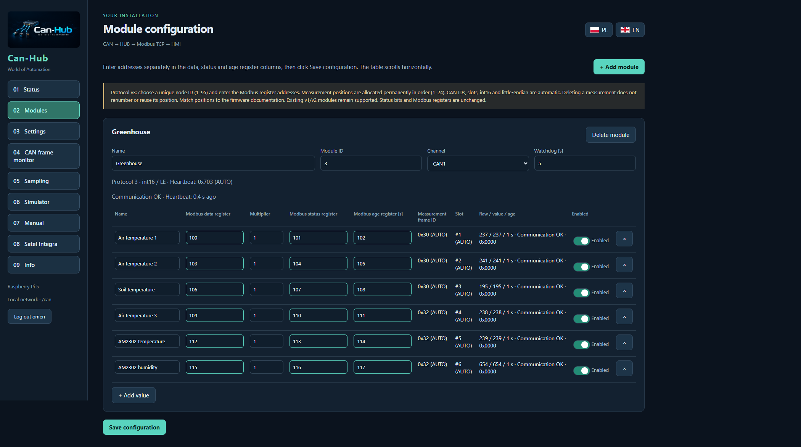
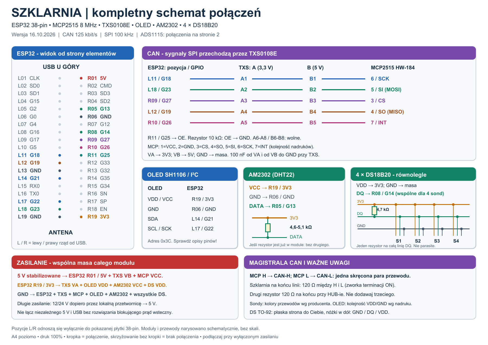
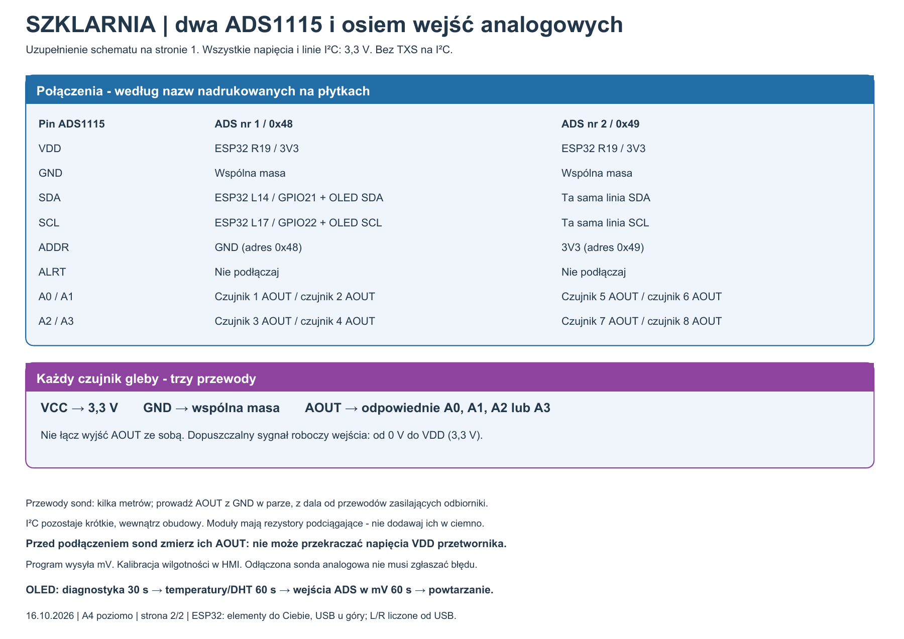
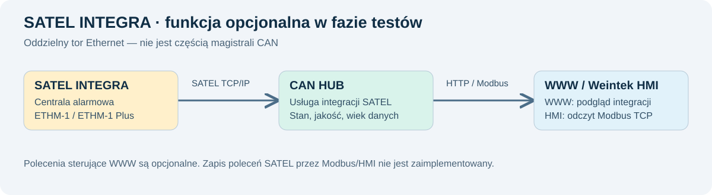
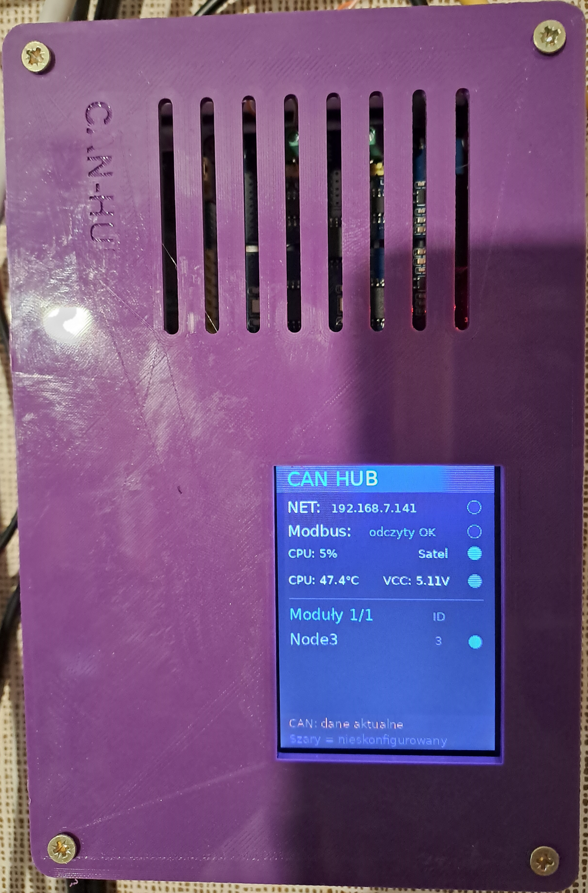

# CAN HUB — World of Automation

**English** | [Polski](README.pl.md)

**Run it yourself:** [installation guide](docs/INSTALL.en.md) · [ESP32 firmware and protocol](docs/FIRMWARE.en.md) · [source tests](scripts/run_tests.py).

CAN HUB connects a wired network of ESP32 measurement modules to a Weintek operator panel. It receives measurements over CAN, checks their validity and freshness, and makes them available over Modbus TCP. Configuration and diagnostics are accessible in a web browser, with essential information also shown on a local display.

This overview introduces CAN HUB and a working application: the greenhouse module. The project is not merely a theoretical concept: it extends a home automation installation that has been operating for several years. The web interface screenshots contain **demonstration data**. The supplied HMI screenshot and photograph of the assembled device show their state at the time they were captured, rather than live readings. The original diagrams retain their Polish labels. Block diagrams show connections and interfaces; the detailed greenhouse wiring diagram appears near the end of the module description.

## 1. CAN HUB — operation and hardware

### Why the project was created

Many devices in my home installation exchanged data over Modbus TCP. As the system expanded, the number of reads and connections increased, and I noticed a decline in home network performance. I decided to move a substantial portion of measurement traffic to a separate, wired CAN bus.

CAN HUB was built as a bridge between measurement modules and the HMI. Measurement traffic from the modules does not require Wi-Fi or the home Ethernet network. In the intended architecture, the Weintek panel retrieves aggregated data from the HUB over a short, dedicated Modbus TCP connection separated from the home network. Administrative web access must be planned separately in the network topology: running the software alone does not provide physical network isolation.

### Components and connections

| Component | Purpose |
|---|---|
| Raspberry Pi 5 | Data reception and processing, Modbus TCP server, web interface, archiving and diagnostics. |
| Waveshare 2-CH CAN HAT | Two CAN channels with MCP2515 controllers, connected to the Raspberry Pi over SPI0. |
| ILI9341 TFT display | Local measurement and system status display, using a separate SPI1 bus. |
| Weintek MT8071iP HMI | Modbus TCP reads and presentation of measurements, trends and diagnostic messages. |
| Debian Trixie | Raspberry Pi operating system running the CAN HUB services. |



Each CAN channel forms a separate bus. CAN H and CAN L use a twisted pair, with a 120 Ω termination resistor at each of the two physical ends of that bus. Wiring must also account for a common GND reference and the power supply arrangement. The HAT connectors CAN0 and CAN1 appear in the operating system as `canhat0` and `canhat1`.

### A consistent protocol for ESP32 modules

The project includes an Arduino library called **CanHubProtocol**. It standardizes CAN identifier allocation, measurement encoding, diagnostic messages and heartbeat generation. A transport library handles the physical MCP2515 controller; the module application is also responsible for sensor acquisition and hardware initialization.

Each module receives a unique `NODE_ID` from 1 to 95 on its CAN channel. The library calculates frame identifiers automatically. Users do not need to assign frame identifiers or byte offsets manually for successive measurements.

Protocol v3 uses standard CAN frames with 11-bit identifiers and eight data bytes. A measurement frame carries one to three **int16** values, including negative numbers. Each of its three fields has a corresponding 16-bit status field in a second frame. Both frames carry the same protocol version and measurement-set sequence number.

| Bytes | Measurement frame | Status frame |
|---|---|---|
| 0 | Protocol version | Protocol version |
| 1 | Set sequence number | Matching set sequence number |
| 2–3 | Measurement A — int16 | Status A — uint16 |
| 4–5 | Measurement B — int16 | Status B — uint16 |
| 6–7 | Measurement C — int16 | Status C — uint16 |

Byte order is fixed: little-endian. Eight groups of three values provide up to 24 fixed measurement positions per module. Names, units and scaling are defined in the module documentation; they are not transmitted automatically in the frames.

For group `g`, from 0 to 7, the data identifier is `NODE_ID × 16 + 2 × g`, the status identifier is one greater, and the heartbeat identifier is `0x700 + NODE_ID`. The set sequence number advances even when the measured value has not changed. This distinguishes a constant temperature from stalled acquisition.

In the ESP32 application, `publish()` sends a matching data/status pair, while frequent calls to `tick()` handle the periodic heartbeat. Sensor reads must have bounded timeouts so that they do not stall the main loop or communication.

### Health monitoring and data freshness

CAN HUB separately checks module availability, measurement freshness and whether diagnostics match the measurement. In the example configuration, the heartbeat interval is one second, measurements are sent every 2.5 seconds, and the module watchdog timeout is five seconds.

| Condition | System response |
|---|---|
| One sensor fails | Its value becomes 0 and its status indicates an error. Other measurements can continue. |
| ESP32 heartbeat is missing | The HUB zeros the module's enabled measurements and reports the missing heartbeat. |
| Heartbeat continues but new measurements stop | The HUB detects stale data, zeros the measurement and sets the appropriate status. |
| No status frame matches the measurement set | The measurement is not treated as valid; the HUB reports missing current diagnostics. |
| A measurement is disabled with its switch | Value and age become 0, and the status indicates disabled. This is not a sensor alarm. |
| The HMI loses its connection to the HUB | The panel macro replaces old indications with “BRAK HUB” (“NO HUB”). |

A heartbeat indicates that the module application is alive; it does not confirm that all sensors are healthy. A sensor fault should not stop heartbeat transmission. Similarly, a response from the Modbus server does not prove that a measurement is fresh.

### HMI integration

For each configured measurement, CAN HUB exposes three independently addressed registers: **value**, **status bitmask** and **data age in seconds**. The user chooses the addresses. Renaming a module or sensor therefore does not change its HMI mapping.

The current read path uses Modbus TCP, port 502, Unit ID 1 and function FC03. Addresses in the HUB configuration are zero-based protocol addresses. The panel driver must use a compatible addressing convention. Measurements are signed values; status and age must be interpreted as unsigned 16-bit values.

An HMI macro copies the data into local LW registers. Numeric displays read those registers, while Word Lamp objects receive a separately calculated message-state index. **A status bitmask is not a Word Lamp state index.** Multiple bits can be set at once; a defined priority determines which message is displayed.

The CAN hardware supports bidirectional communication. Controlling ESP32 modules through Modbus register writes and CAN commands remains a planned extension, however. The CAN–Modbus–HMI path described here currently provides reading and monitoring.

### Configuration and diagnostic tools

The web interface is available at `/can`. Modules are added manually by specifying their identifier, CAN channel and monitoring parameters. Measurements have fixed positions matching the ESP32 application and their own Modbus register addresses. Deleting a position does not renumber the others.



*Demonstration view of connections, modules, buses and Raspberry Pi status.*

Key features include:

- measurements, status, data age and communication error monitoring;
- enabling or disabling publication of individual measurements;
- a passive CAN frame monitor showing bytes, bits, sequences and reception timing;
- a simulator at `/sym`, including a preview of the image sent to the LCD;
- JSON configuration export and import, with a choice between adding missing entries and replacing the configuration;
- network and administrator account settings, plus a local password reset utility;
- optional FTP retrieval of trend files from a compatible HMI, preservation of original files, charts, archive downloads to a computer and file deletion from the Raspberry Pi.

The frame monitor distinguishes raw status received from the ESP32 from the effective status exposed to the HMI, which also includes the HUB's monitoring results. In status fields, green means 0, red means 1 and grey marks reserved fields. Measurement bytes are blue; headers and heartbeat fields are yellow.



*Example of matching measurement and diagnostic frames, together with an independent heartbeat.*

A JSON backup stores configuration, including register addresses and enabled/disabled states. It does not replace backups of the Raspberry Pi system, ESP32 firmware or HMI project. The simulator is a testing tool: its values do not replace physical readings in the production Modbus server.

## 2. Greenhouse — an example ESP32 module

### What the module does

The greenhouse is a working example of a device using the CAN HUB protocol. Its earlier version communicated over Wi-Fi, and measurements reached the HMI through a Siemens LOGO controller. The current ESP32 version sends measurements to CAN HUB over a wired connection and requires neither Wi-Fi nor a local Modbus server.

The module supports four DS18B20 temperature sensors, AM2302 air temperature and humidity measurements, and eight analog inputs provided by two ADS1115 converters. The analog inputs can be used for soil moisture probes, among other applications. The ESP32 reports voltage in millivolts; calibration and conversion to moisture readings take place in the HMI.

### Components

| Component | Role in the greenhouse module |
|---|---|
| ESP32-WROOM-32 development board | Sensor acquisition, status generation, OLED handling and CAN transmission. |
| MCP2515 CAN module with an 8 MHz crystal | Connects the ESP32 to the CAN bus at 125 kbit/s. |
| TXS0108E | Logic-level translation between the 3.3 V ESP32 and the 5 V CAN module used in this build; SPI runs at 100 kHz. |
| 4 × DS18B20 | Separate temperature measurement points on a shared 1-Wire line. |
| AM2302, compatible with DHT22 | Air temperature and humidity at the sensor location. |
| 2 × ADS1115 | Eight analog inputs in total, powered at 3.3 V, with I²C addresses 0x48 and 0x49. |
| 128 × 64 OLED with SH1106 controller | Local diagnostic and measurement display. |

### Connections



| ESP32 connection | Purpose |
|---|---|
| GPIO14 | Shared DS18B20 DQ line, with a 4.7 kΩ resistor to 3.3 V. |
| GPIO13 | AM2302 data, pulled up to 3.3 V; approximately 4.6 kΩ in the assembled module. |
| GPIO21 / GPIO22 | SDA / SCL: OLED and both ADS1115 converters connected in parallel. |
| GPIO18 / GPIO23 / GPIO19 | CAN controller SCK / MOSI / MISO through the TXS0108E. |
| GPIO27 / GPIO26 | CAN module CS / INT through the TXS0108E. |
| GPIO25 | Level translator OE control; a 10 kΩ resistor between OE and GND keeps it disabled during startup. |

The table uses GPIO numbers, not physical header pin numbers. The DS18B20 sensors use a standard three-wire connection with a separate power supply, not parasite power. Their individual ROM addresses preserve the S1–S4 assignments.

The OLED and ADS1115 converters share the I²C bus. ADDR is connected to GND on the first ADS and to 3.3 V on the second. A0–A3 on the first converter correspond to Analog 1–4; A0–A3 on the second correspond to Analog 5–8. ALRT pins are unused. With the ADS powered at 3.3 V, input signals must remain within the permitted range relative to that supply; the PGA range setting does not increase the permitted pin voltage.

### Acquisition, display and transmission

The measurement cycle is approximately 2.5 seconds. DS18B20 temperature conversion runs asynchronously so the module can continue servicing communication while waiting. After startup, the OLED shows diagnostics for 30 seconds. It then alternates every minute between two screens: temperatures and air humidity, and the eight analog voltages.

The module uses `NODE_ID = 3`. Fourteen measurements occupy five frame pairs, while an additional pair carries technical metadata. This produces 12 frames per measurement cycle, plus a separate heartbeat every second.

| Positions | Contents | Data / status IDs, decimal |
|---|---|---|
| 1–3 | DS18B20 S1, S2, S3 | 48 / 49 |
| 4–6 | DS18B20 S4, AM2302 temperature, AM2302 humidity | 50 / 51 |
| 7–9 | Analog 1–3, mV | 52 / 53 |
| 10–12 | Analog 4–6, mV | 54 / 55 |
| 13–15 | Analog 7–8 and an unused third field | 56 / 57 |
| 22–24 | Cycle counter, DS count detected at startup, reserved field | 62 / 63 |
| Heartbeat | Independent counter, module flags and uptime | 1795, or 0x703 |

Temperatures and AM2302 humidity are transmitted with one decimal place: for example, `-55` represents −5.5°C, and `654` represents 65.4% RH. Analog inputs are transmitted in whole millivolts.

A sensor failure does not automatically invalidate the other values in the same frame. Shared wiring still matters: a short circuit on the 1-Wire line can prevent multiple DS18B20 sensors from being read. An ADS1115 voltage reading does not prove that a probe is connected either; a floating input can produce an apparent measurement.

The switch in the HUB disables publication of the measurement to the HMI, not sensor power or the local OLED reading. The detected DS18B20 count describes discovery at startup; it does not replace continuous monitoring of individual sensor status.

### HMI reading example and macro documentation



*Greenhouse page in the Weintek HMI project: four DS18B20 temperatures, AM2302 temperature and humidity, and eight ADS1115 inputs. Columns show the reading, status, data age and Word Lamp message. In this screenshot, analog inputs are disabled: bitmask value 4 means bit 2 is set, not a fault. Blue lamps indicate disabled inputs and green lamps indicate OK. OK reflects the software checks; it is not an independent confirmation of sensor accuracy. The original HMI screenshot retains its Polish labels.*



*Demonstration view of the first six measurements: fixed positions, data/status/age addresses and publication switches.*

The documentation includes the [complete macro 47 for 14 measurements](examples/Makro47_CAN_HUB_14_pomiarow.txt) and an [export containing its periodic execution settings](examples/47_CAN_HUB_odczyt.ebm). These are copies from the existing project's export, provided as integration examples. For a new project, adapt device names and reserve unused LW/LB memory. No new HMI version was compiled or uploaded while preparing this overview. The original macro files retain their Polish comments; the operation is explained in English below.

The macro runs once per second: in the export, setting `10` means ten units of 100 ms. It reads the HUB header and a block of 42 Modbus registers, 100–141: fourteen triples of value, status and age. The Modbus header has its own version, `2`; this must not be confused with CAN protocol version `3`.

The following excerpt illustrates the read operation. It is not a standalone macro: variable declarations, connection monitoring and status decoding are in the complete example.

```text
// Modbus header: interface version and HUB liveness counter.
GetDataEx(header[0], "CAN_HUB", 4x, 0, 2)
GetError(err)
// A read error must invalidate the data set.
if err <> 0 then
    valid = false
end if

// 14 measurements: value, status and age for each measurement.
GetDataEx(data[0], "CAN_HUB", 4x, 100, 42)
GetError(err)
if err <> 0 then
    valid = false
end if

// Only after handling HUB loss and calculating message states:
SetData(data[0], "Weintek", LW, 700, 18)
SetData(s1Lamp, "Weintek", LW, 724, 1)
```

The first six triples are written to LW700–717. Analog inputs use a separate area to avoid overwriting connection-monitoring memory.

| Measurement | Modbus: value / status / age | HMI LW: value / status / age | Word Lamp LW |
|---|---|---|---|
| DS18B20 S1 | 100 / 101 / 102 | 700 / 701 / 702 | 724 |
| DS18B20 S2 | 103 / 104 / 105 | 703 / 704 / 705 | 725 |
| DS18B20 S3 | 106 / 107 / 108 | 706 / 707 / 708 | 726 |
| DS18B20 S4 | 109 / 110 / 111 | 709 / 710 / 711 | 727 |
| AM2302 temperature | 112 / 113 / 114 | 712 / 713 / 714 | 728 |
| AM2302 humidity | 115 / 116 / 117 | 715 / 716 / 717 | 729 |
| Analog 1 | 118 / 119 / 120 | 800 / 801 / 802 | 803 |
| Analog 2 | 121 / 122 / 123 | 804 / 805 / 806 | 807 |
| Analog 3 | 124 / 125 / 126 | 808 / 809 / 810 | 811 |
| Analog 4 | 127 / 128 / 129 | 812 / 813 / 814 | 815 |
| Analog 5 | 130 / 131 / 132 | 816 / 817 / 818 | 819 |
| Analog 6 | 133 / 134 / 135 | 820 / 821 / 822 | 823 |
| Analog 7 | 136 / 137 / 138 | 824 / 825 / 826 | 827 |
| Analog 8 | 139 / 140 / 141 | 828 / 829 / 830 | 831 |

LW720–723 store the previous HUB counter, its repetition count, a monitoring-initialization flag and the communication state. LB700 indicates that the connection is considered active. The macro checks read errors and the header version. Four consecutive counter repetitions indicate that the counter has stopped advancing. At a one-second macro interval, this takes approximately four seconds, plus any communication and execution delays.

When the connection is lost, local values are zeroed, age becomes `65535`, and indicators show “BRAK HUB” (“NO HUB”). The macro then uses local status marker `11`; **this must not be interpreted as a CAN bitmask**. The age field must be unsigned and wide enough for five digits. On the first successful read after initialization, the macro initially shows a waiting state.

Message priority is as follows: HUB unavailable or initial monitoring; then, while connected, measurement disabled, module heartbeat missing, stale measurement, missing matching diagnostics, configuration error, range/overflow/saturation, format error, sensor communication error, measurement not ready, CRC error, timeout, other error and general error. With no status bits set, the state is OK. The complete bitmask remains available regardless of the single message selected for display.

There are three distinct checks: **the HMI monitors the HUB**, **the HUB monitors the ESP32 heartbeat**, and **the HUB also checks the freshness and matching sequence of measurement and status frames**. None replaces the others. Validate the example by disconnecting one sensor, stopping measurements while maintaining heartbeat transmission, disconnecting the CAN module, interrupting Ethernet and disabling a measurement with its switch.

### Greenhouse electrical wiring diagram

The diagram covers power, the ESP32, TXS0108E translator, CAN module, OLED, AM2302, four DS18B20 sensors and two ADS1115 converters. L/R labels identify physical header positions on the illustrated 38-pin ESP32 board, viewed from the component side with USB at the top. Do not apply these positions to another board variant without checking its layout. The original wiring sheets below retain their Polish annotations; component names, GPIO assignments and electrical values are also described in the tables above.





[Download the complete wiring diagram — PDF, two A4 pages](assets/szklarnia-schemat-elektryczny.pdf).

### Additional CAN HUB feature — SATEL INTEGRA

Alongside measurement modules, CAN HUB can communicate with a SATEL INTEGRA alarm control panel through an ETHM-1 or ETHM-1 Plus Ethernet module. This is a separate communication path using SATEL's binary integration protocol over TCP/IP, not CAN. The HUB sends queries, checks response framing and checksums, and updates the local integration state.



The integration includes zone/input, output and partition states, armed status, alarms, tamper conditions and fault diagnostics. Selected information is available through the web interface and Modbus registers, together with data quality and age. SATEL quality codes have their own meaning and are not CAN sensor error bitmasks. A separate service polls the panel so that waiting for a response does not block CAN communication.

The implementation also includes optional web commands requiring separate enablement, a user code and confirmation. This is not alarm control through Modbus writes from the HMI. The current integration protocol implementation does not support the encrypted variant.

**SATEL INTEGRA integration is in the testing phase. Readout and diagnostic coverage are being developed, and the physical effects of control commands have not yet been verified by tests on the working alarm installation.**

### CAN HUB in its enclosure



*The assembled CAN HUB in its 3D-printed enclosure. The ILI9341 display shows network and Modbus read status, CPU load and temperature, VCC voltage and module status. Slots in the cover provide ventilation.*

CAN HUB provides two interface language packs: **Polish and English**.

## License

Copyright © 2026 Adam Wojcieszonek. This project is distributed under the [GNU General Public License v3.0](LICENSE).
