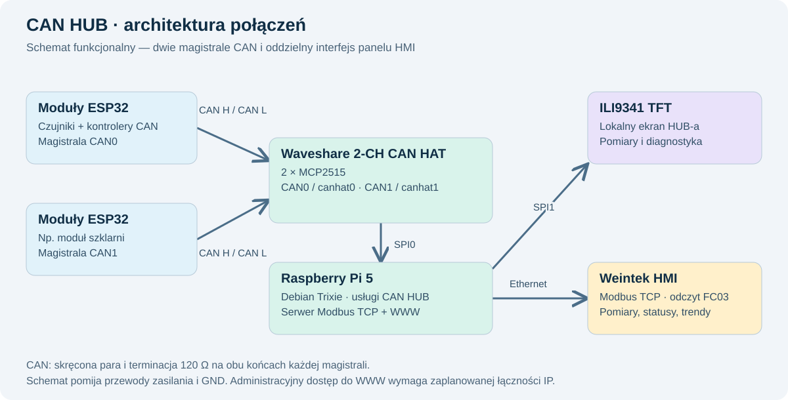
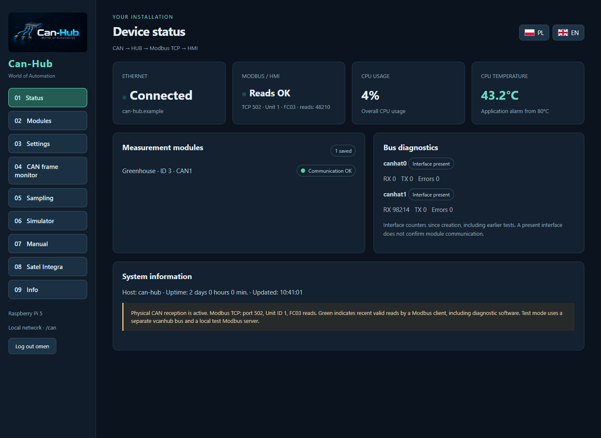
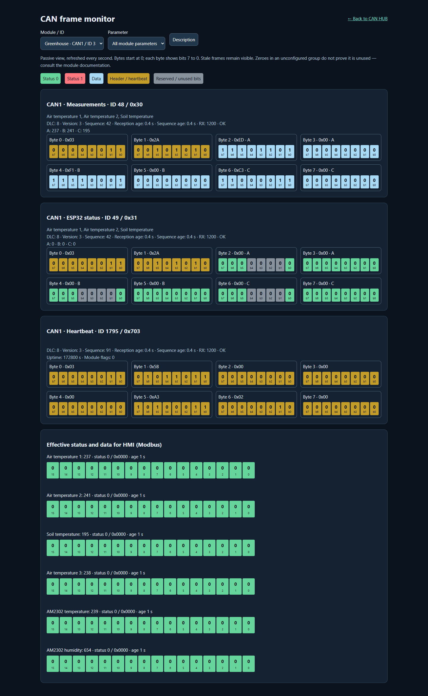
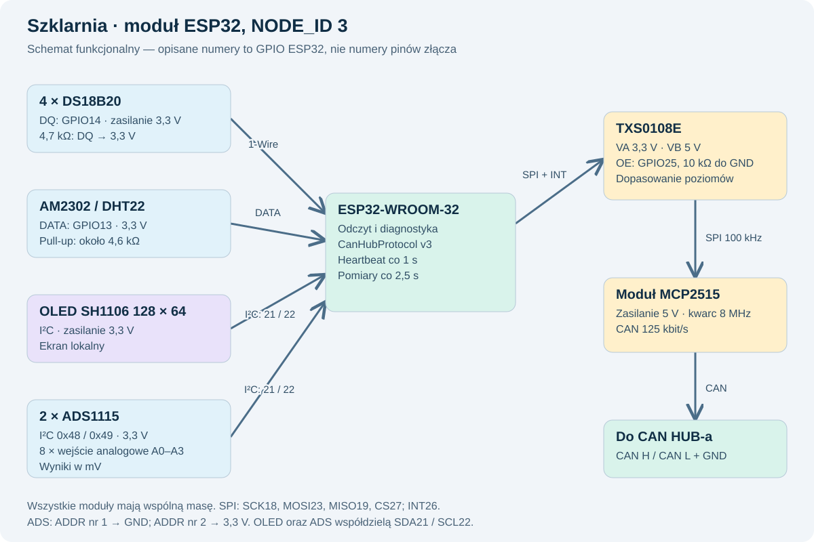
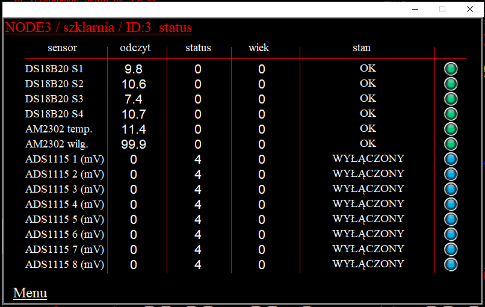
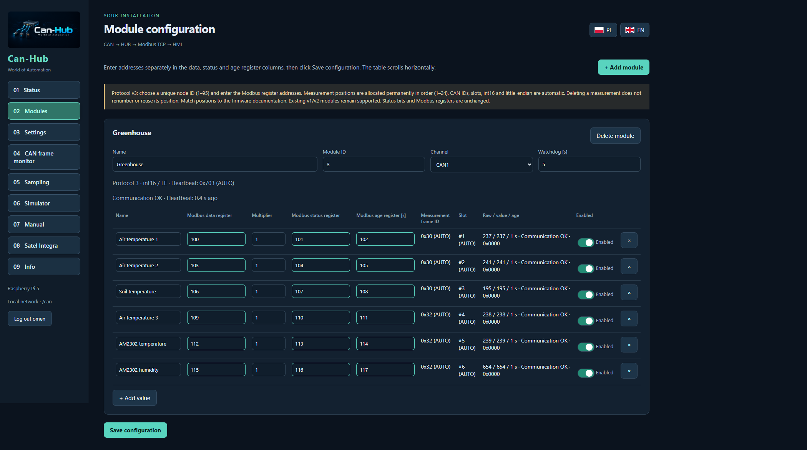
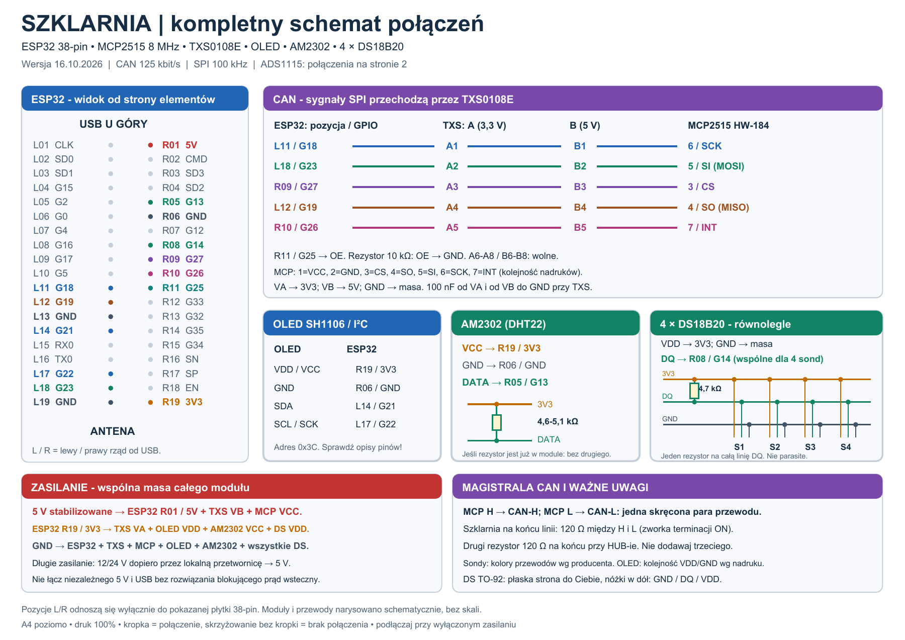
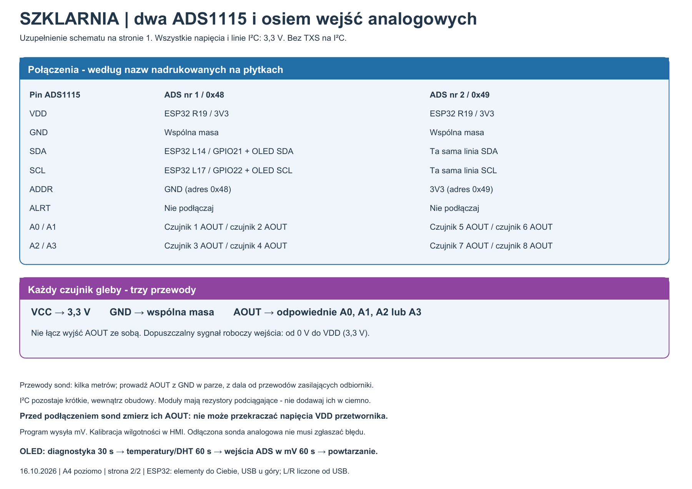
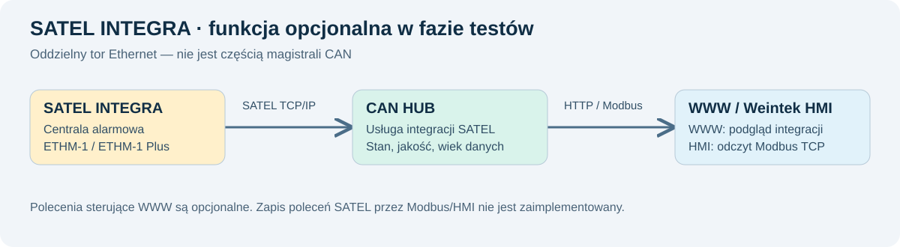
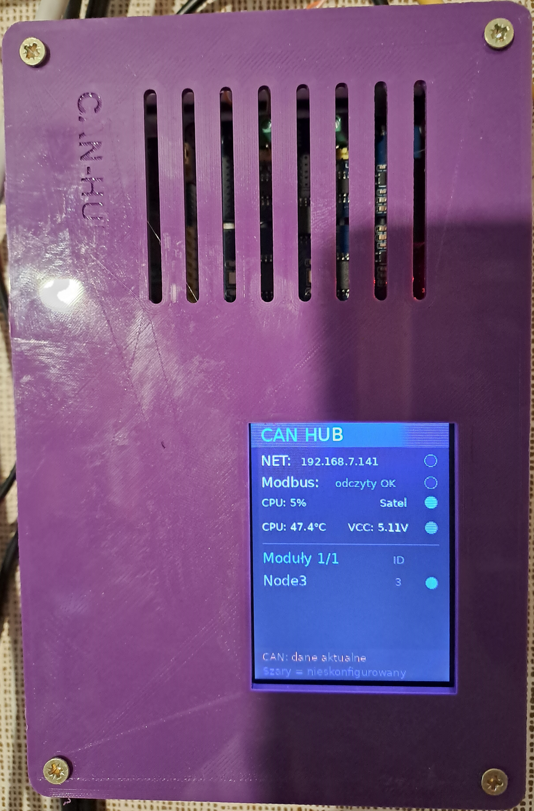

# CAN HUB — World of Automation

[English](README.md) | **Polski**

**Uruchomienie u siebie:** [instrukcja instalacji](docs/INSTALL.pl.md) · [firmware ESP32 i protokół](docs/FIRMWARE.en.md) · [testy źródeł](scripts/run_tests.py).

CAN HUB łączy przewodową sieć modułów pomiarowych ESP32 z panelem operatorskim Weintek. Odbiera pomiary przez magistralę CAN, kontroluje ich poprawność i aktualność, a następnie udostępnia je przez Modbus TCP. Konfiguracja i diagnostyka są dostępne w przeglądarce, a najważniejsze informacje również na lokalnym wyświetlaczu.

Opis przedstawia centralę CAN HUB oraz działający przykład jej zastosowania — moduł szklarni. Projekt nie jest wyłącznie koncepcją teoretyczną: stanowi rozbudowę domowej instalacji automatyki działającej od kilku lat. Zrzuty interfejsu zawierają **dane demonstracyjne**. Osobno zamieszczono dostarczony widok ekranu HMI oraz zdjęcie urządzenia w obudowie — pokazują stan w chwili wykonania, nie bieżące odczyty. Schematy blokowe przedstawiają połączenia i interfejsy; szczegółowy schemat elektryczny modułu szklarni znajduje się w końcowej części jego opisu.

## 1. CAN HUB — działanie i budowa

### Dlaczego powstał projekt

W mojej domowej instalacji wiele urządzeń wymieniało dane przez Modbus TCP. Wraz z rozbudową systemu wzrosła liczba odczytów i połączeń, a w instalacji zauważyłem pogorszenie wydajności sieci domowej. Postanowiłem przenieść znaczną część komunikacji pomiarowej na osobną, przewodową magistralę CAN.

CAN HUB powstał jako urządzenie pośredniczące pomiędzy modułami pomiarowymi a HMI. Ruch pomiarowy z modułów nie wymaga Wi-Fi ani domowej sieci Ethernet. W założonej architekturze panel Weintek pobiera zbiorcze dane z HUB-a przez krótkie, wydzielone połączenie Modbus TCP, oddzielone od sieci domowej. Dostęp administracyjny do WWW należy uwzględnić osobno w topologii sieci — samo uruchomienie programu nie zapewnia jej fizycznej izolacji.

### Podzespoły i połączenia

| Podzespół | Zadanie |
|---|---|
| Raspberry Pi 5 | Odbiór i przetwarzanie danych, serwer Modbus TCP, interfejs WWW, archiwizacja i diagnostyka. |
| Waveshare 2-CH CAN HAT | Dwa kanały CAN z kontrolerami MCP2515, połączone z Raspberry Pi przez SPI0. |
| Wyświetlacz TFT ILI9341 | Lokalny podgląd pomiarów i stanu systemu; osobna magistrala SPI1. |
| Panel Weintek MT8071iP | Odczyt danych po Modbus TCP, prezentacja pomiarów, trendów i komunikatów diagnostycznych. |
| Debian Trixie | System operacyjny Raspberry Pi, na którym pracują usługi CAN HUB-a. |



Każdy kanał CAN tworzy osobną magistralę. CAN H i CAN L prowadzone są skręconą parą, z terminacją 120 Ω na dwóch fizycznych końcach danej magistrali. Wspólny punkt odniesienia GND oraz sposób zasilania należy uwzględnić w okablowaniu. Złącza nakładki CAN0 i CAN1 są w systemie rozpoznawane jako `canhat0` i `canhat1`.

### Stały protokół dla modułów ESP32

Do projektu powstała biblioteka Arduino **CanHubProtocol**. Ujednolica sposób nadawania identyfikatorów ramek, pakowania pomiarów, przesyłania diagnostyki i generowania heartbeatu. Obsługa fizycznego kontrolera MCP2515 odbywa się przez bibliotekę transportową; program modułu odpowiada także za odczyt czujników i inicjalizację sprzętu.

Każdy moduł otrzymuje unikalny `NODE_ID` z zakresu 1–95 na danym kanale CAN. Biblioteka automatycznie wylicza identyfikatory ramek. Użytkownik nie musi sam dobierać numerów ramek ani numerów bajtów dla kolejnych pomiarów.

Protokół v3 używa standardowych ramek CAN z 11-bitowym identyfikatorem i ośmioma bajtami danych. Jedna ramka pomiarowa zawiera od jednej do trzech liczb **int16**, także ujemnych. Każdemu z trzech pól odpowiada osobne 16-bitowe pole statusu w drugiej ramce. Obie ramki mają tę samą wersję protokołu i numer zestawu pomiarów.

| Bajty | Ramka pomiarów | Ramka statusów |
|---|---|---|
| 0 | Wersja protokołu | Wersja protokołu |
| 1 | Numer zestawu | Ten sam numer zestawu |
| 2–3 | Pomiar A — int16 | Status A — uint16 |
| 4–5 | Pomiar B — int16 | Status B — uint16 |
| 6–7 | Pomiar C — int16 | Status C — uint16 |

Kolejność bajtów jest stała: little-endian. Osiem grup po trzy wartości daje do 24 stałych pozycji na moduł. Nazwy, jednostki oraz skalę pomiarów określa dokumentacja danego modułu — nie są automatycznie przesyłane w ramkach.

Dla grupy `g` od 0 do 7 identyfikator danych wynosi `NODE_ID × 16 + 2 × g`, identyfikator statusu jest o jeden większy, a heartbeat ma identyfikator `0x700 + NODE_ID`. Numer zestawu zwiększa się także wtedy, gdy wartość pomiaru się nie zmieniła. Dzięki temu stała temperatura nie jest mylona z zatrzymaniem pomiarów.

W programie ESP32 funkcja `publish()` wysyła parę danych i statusów, a często wywoływana funkcja `tick()` obsługuje okresowy heartbeat. Odczyty czujników muszą mieć ograniczony czas oczekiwania, aby nie zatrzymywały głównej pętli i komunikacji.

### Kontrola działania i świeżości danych

CAN HUB sprawdza osobno obecność modułu, aktualność pomiaru i zgodność diagnostyki z pomiarem. W przykładowej konfiguracji heartbeat jest nadawany co sekundę, pomiary co 2,5 sekundy, a czas nadzoru modułu wynosi 5 sekund.

| Sytuacja | Zachowanie systemu |
|---|---|
| Błąd jednego czujnika | Jego wartość wynosi 0, a status wskazuje błąd. Pozostałe pomiary mogą nadal działać. |
| Brak heartbeatu ESP32 | HUB zeruje aktywne pomiary modułu i sygnalizuje utratę jego sygnału życia. |
| Heartbeat działa, ale nie przychodzą nowe pomiary | HUB rozpoznaje nieaktualne dane, zeruje pomiar i ustawia odpowiedni status. |
| Brakuje statusu pasującego do zestawu pomiarów | Pomiar nie jest traktowany jako poprawny; HUB sygnalizuje brak aktualnej diagnostyki. |
| Pomiar wyłączono suwakiem | Wartość i wiek wynoszą 0, status oznacza wyłączenie. Nie jest to alarm czujnika. |
| HMI traci połączenie z HUB-em | Makro panelu zastępuje stare wskazania stanem „BRAK HUB”. |

Heartbeat jest sygnałem życia programu modułu, a nie potwierdzeniem sprawności wszystkich jego czujników. Błąd czujnika nie powinien zatrzymywać nadawania heartbeatu. Z kolei sama odpowiedź serwera Modbus nie dowodzi, że pomiar jest świeży.

### Współpraca z HMI

CAN HUB udostępnia dla każdego skonfigurowanego pomiaru trzy niezależnie adresowane rejestry: **wartość**, **status bitowy** oraz **wiek danych w sekundach**. Adresy wybiera użytkownik. Dzięki temu zmiana nazwy modułu lub czujnika nie zmienia powiązań z HMI.

Obecna ścieżka odczytu wykorzystuje Modbus TCP, port 502, Unit ID 1 i funkcję FC03. Adresy w konfiguracji HUB-a są adresami protokołu liczonymi od zera. W panelu trzeba dobrać zgodną konwencję adresowania sterownika. Pomiar jest liczbą ze znakiem, natomiast status i wiek należy interpretować jako 16-bitowe wartości bez znaku.

Makro HMI pobiera dane do lokalnych rejestrów LW. Pola liczbowe odczytują te rejestry, a kontrolki Word Lamp otrzymują oddzielnie wyliczony numer komunikatu. **Maska bitowa statusu nie jest numerem stanu Word Lamp.** Kilka bitów może być ustawionych jednocześnie; o wyświetlanym komunikacie decyduje ustalone pierwszeństwo.

Sprzęt CAN pozwala na komunikację dwukierunkową. Sterowanie modułami ESP32 przez zapis rejestrów Modbus i polecenia CAN pozostaje jednak planowanym rozszerzeniem. Opisana tu ścieżka CAN–Modbus–HMI służy obecnie do odczytu i monitorowania.

### Konfiguracja i narzędzia diagnostyczne

Interfejs WWW jest dostępny pod adresem `/can`. Moduły dodaje się ręcznie, podając identyfikator, kanał CAN i parametry nadzoru. Kolejne pomiary mają stałe pozycje zgodne z programem ESP32 oraz własne adresy rejestrów Modbus. Usunięcie pozycji nie przesuwa pozostałych.



*Widok demonstracyjny: stan połączeń, modułów, magistral i Raspberry Pi.*

Najważniejsze funkcje obejmują:

- podgląd pomiarów, statusów, wieku danych i błędów komunikacji;
- włączanie i wyłączanie publikowania poszczególnych pomiarów;
- pasywny monitor ramek CAN pokazujący bajty, bity, sekwencje i czas odbioru;
- symulator pod adresem `/sym`, w tym podgląd obrazu przeznaczonego dla LCD;
- eksport i import konfiguracji JSON z wyborem uzupełnienia brakujących elementów albo zastąpienia konfiguracji;
- ustawienia sieci i konta administratora oraz lokalne narzędzie resetowania hasła;
- opcjonalne pobieranie plików trendów z kompatybilnego HMI przez FTP, zachowanie oryginalnych plików, wykresy, pobieranie archiwum na komputer i usuwanie plików z Raspberry Pi.

Monitor rozróżnia surowy status odebrany z ESP32 od statusu udostępnianego HMI, uzupełnionego o wynik kontroli prowadzonej przez HUB. W polach statusu zielony bit oznacza 0, czerwony 1, a szary pole zarezerwowane. Ramki pomiarowe wyróżniono na niebiesko, a nagłówki i heartbeat na żółto.



*Przykład pary ramek pomiarowych i diagnostycznych oraz niezależnego heartbeatu.*

Kopia JSON zapisuje konfigurację, w tym adresy rejestrów i stany przełączników. Nie zastępuje kopii systemu Raspberry Pi, programów ESP32 ani projektu HMI. Symulator służy do testów; jego dane nie zastępują rzeczywistych odczytów w produkcyjnym serwerze Modbus.

## 2. Szklarnia — przykładowy moduł ESP32

### Zadanie modułu

Szklarnia jest działającym przykładem urządzenia zgodnego z protokołem CAN HUB. Wcześniejsza wersja komunikowała się przez Wi-Fi, a dane trafiały do HMI za pośrednictwem sterownika Siemens LOGO. Obecna wersja ESP32 przesyła pomiary przewodowo do CAN HUB-a i nie potrzebuje Wi-Fi ani lokalnego serwera Modbus.

Moduł obsługuje cztery czujniki temperatury DS18B20, pomiar temperatury i wilgotności powietrza AM2302 oraz osiem wejść analogowych z dwóch ADS1115. Wejścia analogowe są przygotowane m.in. do podłączenia sond wilgotności gleby. ESP32 przekazuje napięcie w miliwoltach; kalibracja i przeliczenie na wilgotność odbywają się po stronie HMI.

### Użyte podzespoły

| Podzespół | Rola w szklarni |
|---|---|
| ESP32-WROOM-32 na płytce rozwojowej | Odczyt czujników, przygotowanie statusów, obsługa OLED i transmisja CAN. |
| Moduł CAN z MCP2515, kwarc 8 MHz | Połączenie ESP32 z magistralą CAN; prędkość 125 kbit/s. |
| TXS0108E | Dopasowanie poziomów logicznych pomiędzy ESP32 3,3 V a użytym modułem CAN 5 V; w tej realizacji SPI pracuje z częstotliwością 100 kHz. |
| 4 × DS18B20 | Niezależne punkty pomiaru temperatury na wspólnej linii 1-Wire. |
| AM2302, zgodny z DHT22 | Temperatura i wilgotność powietrza w miejscu zamontowania czujnika. |
| 2 × ADS1115 | Łącznie osiem wejść analogowych, zasilanie 3,3 V, adresy I²C 0x48 i 0x49. |
| OLED 128 × 64 ze sterownikiem SH1106 | Lokalny ekran diagnostyczny i prezentacja pomiarów. |

### Schemat połączeń



| Połączenie ESP32 | Przeznaczenie |
|---|---|
| GPIO14 | Wspólna linia DQ czujników DS18B20, rezystor 4,7 kΩ do 3,3 V. |
| GPIO13 | Dane AM2302, rezystor podciągający do 3,3 V; w wykonanym module około 4,6 kΩ. |
| GPIO21 / GPIO22 | SDA / SCL: OLED oraz oba ADS1115 połączone równolegle. |
| GPIO18 / GPIO23 / GPIO19 | SCK / MOSI / MISO kontrolera CAN, przez TXS0108E. |
| GPIO27 / GPIO26 | CS / INT modułu CAN, przez TXS0108E. |
| GPIO25 | Sterowanie OE konwertera; rezystor 10 kΩ między OE i GND utrzymuje wyłączenie podczas startu. |

Numery w tabeli są numerami GPIO, nie numerami fizycznymi złącza. DS18B20 pracują w standardowym układzie trzyprzewodowym, z osobnym zasilaniem, bez trybu parasite. Ich indywidualne adresy ROM zapewniają stałe przypisanie S1–S4.

OLED i ADS1115 współdzielą magistralę I²C. W pierwszym ADS pin ADDR jest połączony z GND, a w drugim z 3,3 V. Wejścia A0–A3 pierwszego przetwornika odpowiadają Analog 1–4, a drugiego Analog 5–8. Piny ALRT nie są wykorzystywane. Przy zasilaniu ADS z 3,3 V sygnały wejściowe muszą mieścić się w dopuszczalnym zakresie względem tego zasilania; ustawienie zakresu PGA nie podnosi dopuszczalnego napięcia na pinie.

### Pomiary, wyświetlacz i transmisja

Cykl pomiarowy trwa około 2,5 sekundy. Konwersja temperatur DS18B20 odbywa się asynchronicznie, aby podczas oczekiwania moduł mógł nadal obsługiwać komunikację. Po uruchomieniu OLED przez 30 sekund pokazuje diagnostykę. Następnie przełącza co minutę dwa ekrany: temperatury i wilgotność powietrza oraz osiem napięć analogowych.

Moduł ma `NODE_ID = 3`. Czternaście pomiarów zajmuje pięć par ramek, a dodatkowa para przenosi metadane techniczne. Razem jest to 12 ramek na cykl pomiarowy oraz osobny heartbeat co sekundę.

| Pozycje | Zawartość | ID danych / statusu, dziesiętnie |
|---|---|---|
| 1–3 | DS18B20 S1, S2, S3 | 48 / 49 |
| 4–6 | DS18B20 S4, temperatura AM2302, wilgotność AM2302 | 50 / 51 |
| 7–9 | Analog 1–3, mV | 52 / 53 |
| 10–12 | Analog 4–6, mV | 54 / 55 |
| 13–15 | Analog 7–8 i niewykorzystane trzecie pole | 56 / 57 |
| 22–24 | Licznik cykli, liczba DS wykrytych przy starcie, pole rezerwowe | 62 / 63 |
| Heartbeat | Niezależny licznik, flagi modułu i czas pracy | 1795, czyli 0x703 |

Temperatury oraz wilgotność AM2302 są przesyłane z rozdzielczością jednej cyfry po przecinku: przykładowo `-55` oznacza −5,5°C, a `654` oznacza 65,4% RH. Wejścia analogowe są przesyłane w całkowitych miliwoltach.

Awaria jednego czujnika nie unieważnia automatycznie pozostałych wartości z tej samej ramki. Wspólne okablowanie ma jednak znaczenie: zwarcie linii 1-Wire może uniemożliwić odczyt kilku DS18B20 jednocześnie. Odczyt napięcia z ADS1115 także nie dowodzi, że sonda jest podłączona — niepodłączone wejście może pokazywać pozorną wartość.

Przełącznik w HUB-ie wyłącza publikowanie pomiaru do HMI, a nie zasilanie czujnika ani lokalny odczyt na OLED. Liczba wykrytych DS18B20 opisuje wynik wykrywania podczas startu; nie zastępuje bieżącej kontroli statusów poszczególnych sond.

### Przykład odczytu w HMI i dokumentacja makra



*Widok strony szklarni w projekcie Weintek HMI: cztery temperatury DS18B20, temperatura i wilgotność AM2302 oraz osiem wejść ADS1115. Kolumny pokazują odczyt, status, wiek danych i komunikat Word Lamp. Na tym zrzucie wejścia analogowe są wyłączone: status bitowy 4 oznacza ustawiony bit 2, a nie awarię. Niebieskie lampki sygnalizują wyłączenie, zielone stan OK. Status OK potwierdza wynik kontroli programowej; nie stanowi niezależnego potwierdzenia dokładności czujnika.*



*Widok demonstracyjny pierwszych sześciu pomiarów: stałe pozycje, adresy danych, statusu i wieku oraz przełączniki publikowania.*

Do opisu dołączono [pełne makro 47 dla 14 pomiarów](examples/Makro47_CAN_HUB_14_pomiarow.txt) oraz [eksport z ustawieniami cyklicznego wykonywania](examples/47_CAN_HUB_odczyt.ebm). To kopia z eksportu istniejącego projektu, przeznaczona jako przykład integracji. W nowym projekcie trzeba dostosować nazwy urządzeń i zarezerwować wolną pamięć LW/LB. W ramach przygotowania opisu nie wgrywano ani nie kompilowano nowej wersji HMI.

Makro jest wywoływane co sekundę — w jego eksporcie ustawienie `10` oznacza dziesięć jednostek po 100 ms. Odczytuje nagłówek HUB-a i blok 42 rejestrów Modbus 100–141, czyli 14 trójek: wartość, status i wiek. Nagłówek Modbus ma własną wersję `2`; nie należy jej mylić z wersją `3` protokołu CAN.

Poniższy fragment pokazuje zasadę odczytu. Nie stanowi samodzielnego makra — deklaracje zmiennych, kontrola połączenia i dekodowanie statusów znajdują się w pełnym przykładzie.

```text
// Naglowek Modbus: wersja interfejsu oraz licznik zycia HUB-a.
GetDataEx(header[0], "CAN_HUB", 4x, 0, 2)
GetError(err)
// Blad odczytu musi uniewaznic zestaw danych.
if err <> 0 then
    valid = false
end if

// 14 pomiarow: wartosc, status, wiek dla kazdego pomiaru.
GetDataEx(data[0], "CAN_HUB", 4x, 100, 42)
GetError(err)
if err <> 0 then
    valid = false
end if

// Dopiero po obsludze braku HUB-a i wyliczeniu komunikatow:
SetData(data[0], "Weintek", LW, 700, 18)
SetData(s1Lamp, "Weintek", LW, 724, 1)
```

Pierwszych sześć trójek zapisuje się do LW700–717. Wejścia analogowe mają osobny obszar, aby nie nadpisać pamięci kontroli połączenia.

| Pomiar | Modbus: wartość / status / wiek | HMI LW: wartość / status / wiek | Word Lamp LW |
|---|---|---|---|
| DS18B20 S1 | 100 / 101 / 102 | 700 / 701 / 702 | 724 |
| DS18B20 S2 | 103 / 104 / 105 | 703 / 704 / 705 | 725 |
| DS18B20 S3 | 106 / 107 / 108 | 706 / 707 / 708 | 726 |
| DS18B20 S4 | 109 / 110 / 111 | 709 / 710 / 711 | 727 |
| AM2302 temperatura | 112 / 113 / 114 | 712 / 713 / 714 | 728 |
| AM2302 wilgotność | 115 / 116 / 117 | 715 / 716 / 717 | 729 |
| Analog 1 | 118 / 119 / 120 | 800 / 801 / 802 | 803 |
| Analog 2 | 121 / 122 / 123 | 804 / 805 / 806 | 807 |
| Analog 3 | 124 / 125 / 126 | 808 / 809 / 810 | 811 |
| Analog 4 | 127 / 128 / 129 | 812 / 813 / 814 | 815 |
| Analog 5 | 130 / 131 / 132 | 816 / 817 / 818 | 819 |
| Analog 6 | 133 / 134 / 135 | 820 / 821 / 822 | 823 |
| Analog 7 | 136 / 137 / 138 | 824 / 825 / 826 | 827 |
| Analog 8 | 139 / 140 / 141 | 828 / 829 / 830 | 831 |

LW720–723 przechowują poprzedni licznik HUB-a, liczbę jego powtórzeń, znacznik rozpoczęcia obserwacji i stan komunikacji. LB700 informuje o uznaniu połączenia za aktywne. Makro kontroluje błędy odczytu i wersję nagłówka. Cztery kolejne powtórzenia licznika powodują zgłoszenie braku jego postępu; przy cyklu 1 s jest to około 4 sekund, do których mogą dochodzić opóźnienia komunikacji i wykonywania makra.

Po utracie połączenia lokalne wartości są zerowane, wiek przyjmuje `65535`, a kontrolki pokazują „BRAK HUB”. Makro używa wówczas lokalnego znacznika statusu `11`; **nie wolno interpretować go jako maski bitowej CAN**. Pole wieku musi być bez znaku i mieć miejsce na pięć cyfr. Przy pierwszym poprawnym odczycie po inicjalizacji makro najpierw pokazuje oczekiwanie.

Priorytet komunikatów jest następujący: brak HUB-a lub inicjalizacja jego obserwacji; następnie, przy aktywnym połączeniu, wyłączenie pomiaru, brak heartbeatu modułu, brak świeżego pomiaru, brak pasującej diagnostyki, błąd konfiguracji, zakres/przepełnienie/nasycenie, format, komunikacja czujnika, pomiar niegotowy, CRC, timeout, inny błąd i błąd ogólny. Gdy żaden bit nie jest ustawiony, stan oznacza „OK”. Pełna maska pozostaje dostępna niezależnie od pojedynczego komunikatu wybranego do wyświetlenia.

W tym układzie występują trzy różne kontrole: **HMI nadzoruje HUB**, **HUB nadzoruje heartbeat ESP32**, a **HUB dodatkowo nadzoruje świeżość i zgodność ramek pomiarowych oraz statusowych**. Żadna z nich nie zastępuje pozostałych. Przykład należy sprawdzać przez odłączenie pojedynczego czujnika, zatrzymanie pomiarów przy aktywnym heartbeacie, odłączenie modułu CAN, przerwanie Ethernetu oraz wyłączenie pomiaru suwakiem.

### Schemat elektryczny modułu szklarni

Schemat obejmuje połączenia zasilania, ESP32, konwertera TXS0108E, modułu CAN, OLED, AM2302, czterech DS18B20 oraz dwóch ADS1115. Oznaczenia L/R dotyczą fizycznych pozycji złączy pokazanej płytki ESP32 38-pin, oglądanej od strony elementów z USB u góry. Nie należy ich przenosić bez sprawdzenia na inne wersje płytek.





[Pobierz kompletny schemat elektryczny — PDF, dwie strony A4](assets/szklarnia-schemat-elektryczny.pdf).

### Dodatkowa funkcja CAN HUB-a — SATEL INTEGRA

Poza obsługą modułów pomiarowych CAN HUB może współpracować z centralą alarmową SATEL INTEGRA przez moduł Ethernet ETHM-1 lub ETHM-1 Plus. Jest to osobny tor komunikacyjny: wykorzystuje binarny protokół integracyjny SATEL przez TCP/IP, a nie magistralę CAN. HUB wysyła zapytania, sprawdza ramki odpowiedzi i ich sumy kontrolne, a następnie aktualizuje lokalny stan integracji.



Integracja obejmuje m.in. stany wejść, wyjść i stref, czuwanie, alarmy, sabotaże oraz diagnostykę awarii. Wybrane informacje są dostępne w WWW i rejestrach Modbus wraz z jakością oraz wiekiem danych. Jakość danych SATEL ma własną interpretację i nie jest maską błędów czujnika CAN. Osobna usługa obsługuje odpytywanie centrali, aby oczekiwanie na jej odpowiedź nie blokowało komunikacji CAN.

Implementacja zawiera także opcjonalne polecenia z interfejsu WWW, wymagające oddzielnego włączenia, kodu użytkownika i potwierdzenia. Nie jest to sterowanie centralą przez zapis Modbus z HMI. Obecna obsługa protokołu integracyjnego nie obejmuje wariantu szyfrowanego.

**Integracja SATEL INTEGRA jest w fazie testów. Zakres odczytów i diagnostyki jest rozwijany, a fizyczne skutki poleceń sterujących nie zostały jeszcze potwierdzone testami na działającej instalacji alarmowej.**

### CAN HUB w obudowie



*Wykonany CAN HUB w obudowie drukowanej w 3D. Wyświetlacz ILI9341 pokazuje stan sieci i odczytów Modbus, obciążenie i temperaturę CPU, napięcie VCC oraz stan modułów. Szczeliny w pokrywie umożliwiają wentylację wnętrza.*

CAN HUB udostępnia dwa pakiety językowe interfejsu: **polski i angielski**.

## Licencja

Copyright © 2026 Adam Wojcieszonek. Projekt jest udostępniony na licencji [GNU General Public License v3.0](LICENSE).
